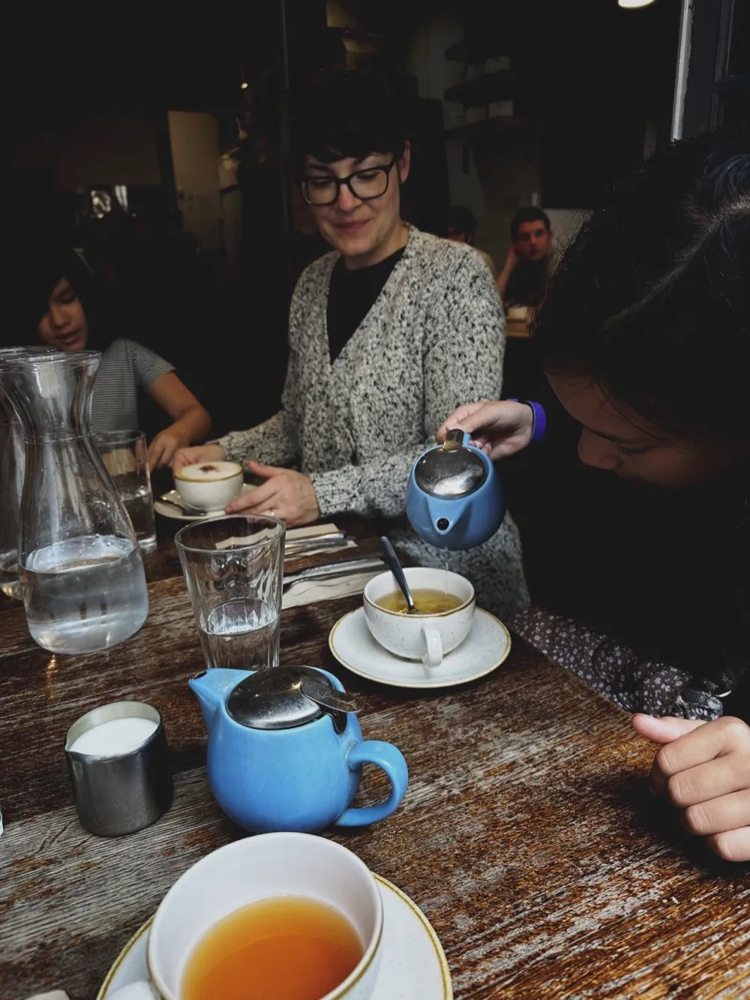
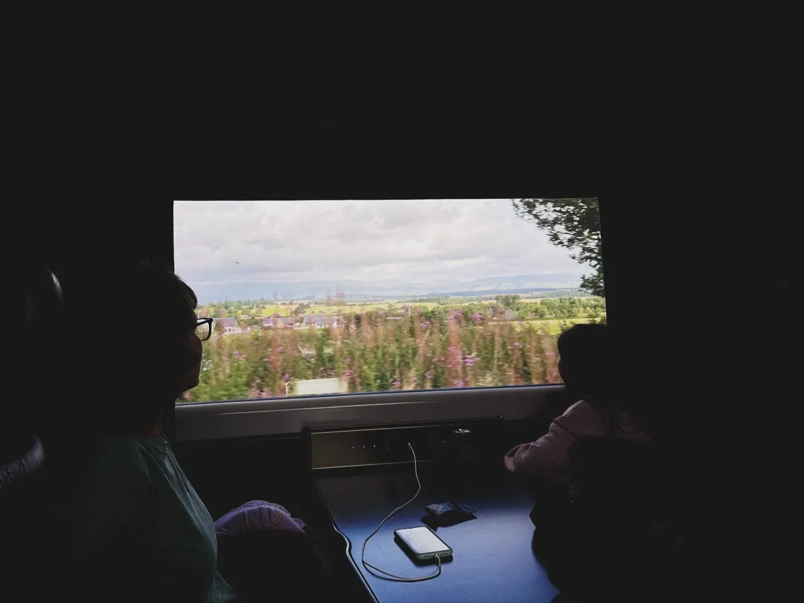
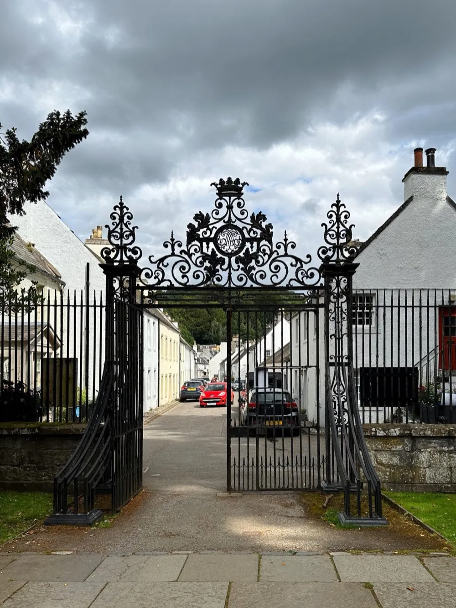
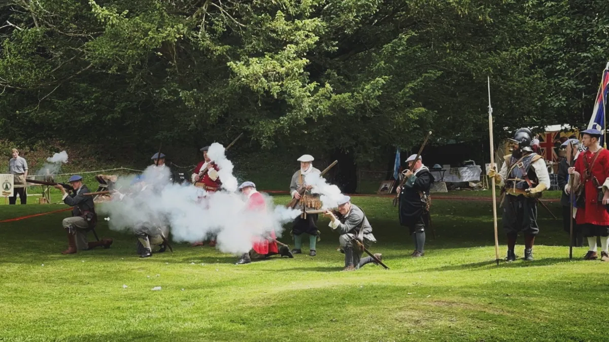
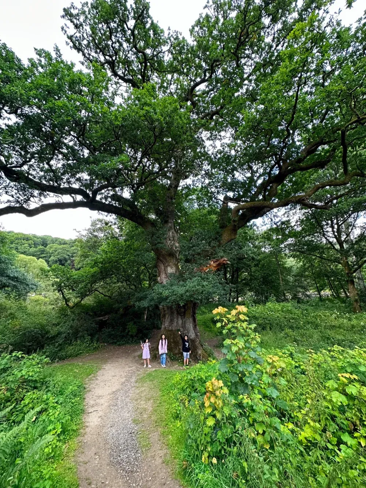
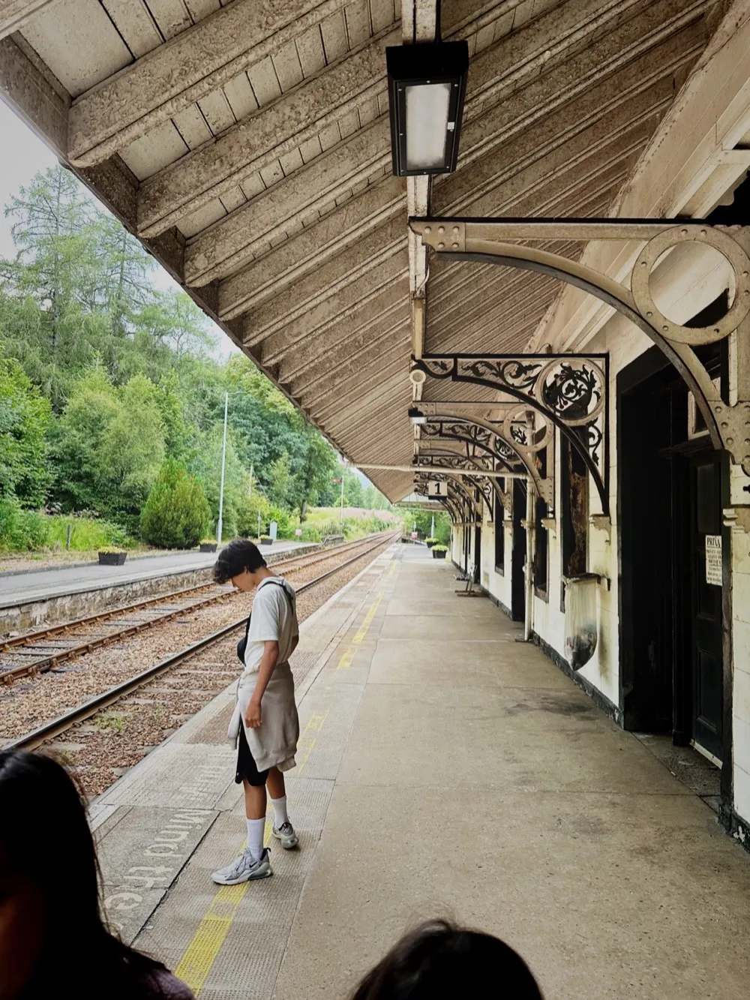
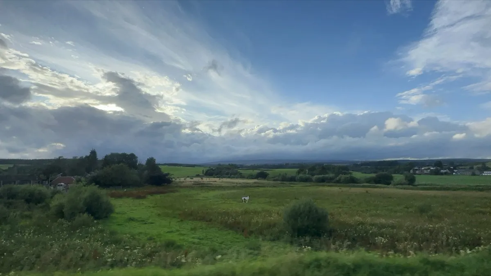
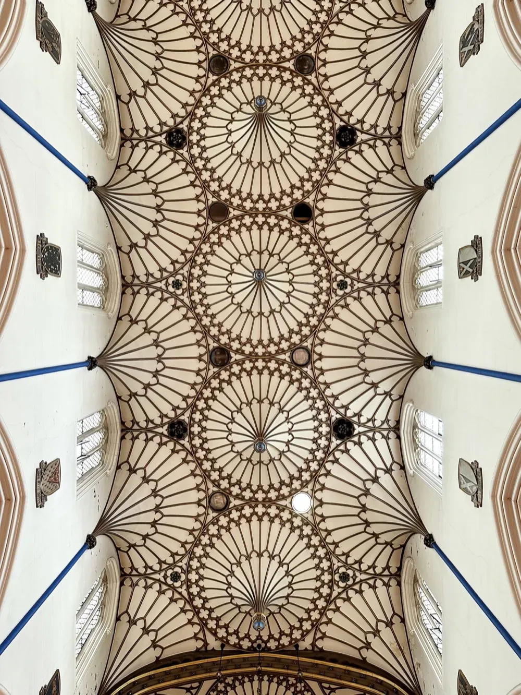
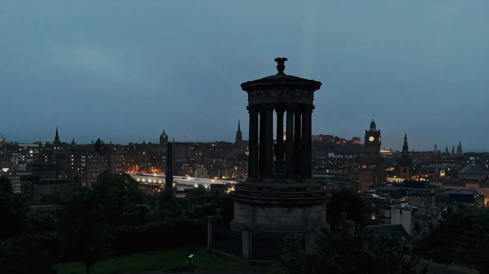

## Dùn Èideann

There's a particular density to Edinburgh, unlike anywhere in the United States. Not just buildings pressed together, but time compressed: centuries side-stacked and still visible if you know how to look. I didn't know how to look, but I looked anyway. Cobblestones. Victorian tenements climbing the hills. Buildings so close they share secrets, I imagined.

## Dunkeld - A Line North

At some point we stopped trying to see everything, and looked outwardly - The Isle of Skye, far north, was appealing, but Skye asked for more time than we had. So it stayed on the map, and it won't be on this trip. 

Dunkeld came up casually, as a place where residents slip away for a day. Still north, but not too northern. Not long after, we were on the platform. The train pulled out of Waverley. Edinburgh receded, with stone faces watching us. Then, grass. Then, hills that rolled without asking permission.

On the train, the density released. This is what (national) trains do -- they also nudge you to stare out the window. The sheep appeared, but they didn't look up. We passed the ground north of the River Forth, where William Wallace had defeated the English in 1297 (I nerded, internally; my family napped through it). We were still heading north to Inverness, but we would step off before then.

At Dunkeld, a station that feels more like a pause than a destination. Modest and unhurried. From there, we would see what walking does. Across the bridge, with the cathedral stood just beyond it. Spare and weathered. And then, without planning it, we chanced into a reenactment of the Battle of Dunkeld (1690). Uniforms. Smoke. Before we left, a reenactor pressed an old lead ball into our hands, dug from nearby ground. We carried the gift the rest of the trip, feeling its weight in my pocket. 

Before we really left, there was one more walk to be made. We followed a path toward Birnam Forest, where an oak tree, that Shakespeare wrote into _Macbeth_, still stands there.[^1] Felt pleasantly medieval. 

## Dùn Èideann - Again

Back in Edinburgh, we went up Arthur's Seat one morning. Wind at the top, and looking down, the city was easier to read from there, the places we’d stopped over the days laid out below.[^2] Another day, we spoke with a stranger, from Germany, who now lives in town. A brief conversation that stretched longer than expected. Somewhere in it, we discover we shared a friend back in Chicago. One of those fun overlaps.

Days later, we went west, back to the United States. Skye stayed on the map, abstract, for now.[^3]

---

## Traces

[^1]: [Ancient Tree Inventory: Birnam Oak](https://ati.woodlandtrust.org.uk/tree-search/tree?treeid=2422#/)
[^2]: A few favorite stops: **Adam Smith Grave** (quiet, easy to miss; still a theorist I re-read) — **Edinburgh Larder** (a [joelgoodman.co](https://joelgoodman.co/) recommendation) — **The Pakora Bar** (owner a memorable character) — **St. John's Church** & **Canongate Kirk** for an evensong — **St. Bernard's Well** (delightful, strangely)
[^3]: Isle of Iona, too.