## London

From the air, on the way to Heathrow, I could see that London doesn't compress the way Edinburgh does. London sprawls and refuses edges. The Thames cuts through, indifferent. Over days, on the grounds, old ones that survived the Blitz of the early 40s standing next to glass towers that didn't exist.

## Oxford - A brief detour

Oxford gave us Addison's Walk. Just a path, maybe a mile, with flowers that had started, like the fields were trying to decide whether to bloom outright or still testing the air of March. (J.R.R. Tolkien and C.S. Lewis had walked here, talking about myth and meaning. The trees, which had stood through all those conversations and many other walkers, gave no sign of remembering that I could listen if they were Ents wanting to tell.) We left the loop with the path settling back into itself behind us.

## Shilton

Stone cottages arranged and looking like they were risen from the ground. We went into Rose & Crown for dinner. Timber-framed, darkened over centuries, and the ceilings low; and I realized looking back, it was low enough to remind taller people of their presumption. The publican said he might be picking up cuts of beef from a farm, across from where we were staying, the next morning. We should come back for supper. He promised to let us know if he'd received enough for my family. We returned, not out of courtesy but curiosity, which then the dish gladdened my hungry heart.

Over days, the silence in Shilton felt chosen, like it had been decided long ago that this kind of silence should be it. Wind moved through branches -- I was far too aware of it. Gravel underfoot, more or less. London could hurry if it liked, but not here.

## London & Friends

It was time to see our friends. We walked to their house through a neighborhood of brick semis and hedges kept to a height that suggested an agreement between neighbors. They took us to Epping Forest. The ground was mud and leaf litter and root with paths that fork without explanation, and you choose one.

By the time we returned to central London, I thought of comparing: London doesn’t wait. Shilton does. Oxford walks beside you. Traversing reminds me that it isn’t so much about collecting differences between places as it is about learning which rhythms your body notices.

---

## Traces

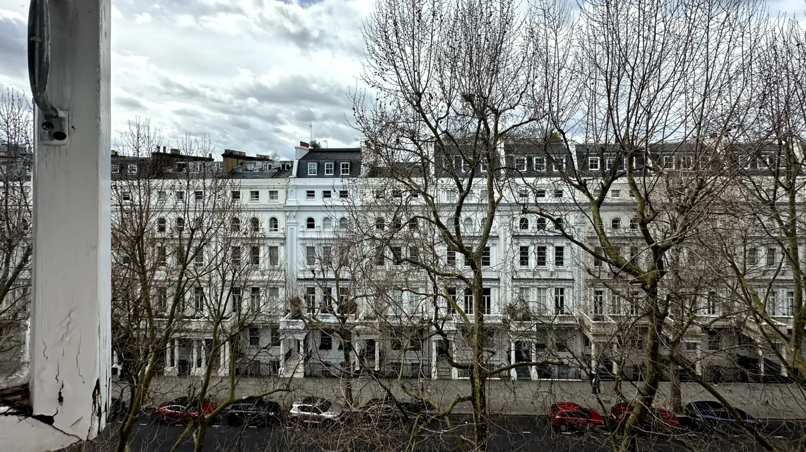
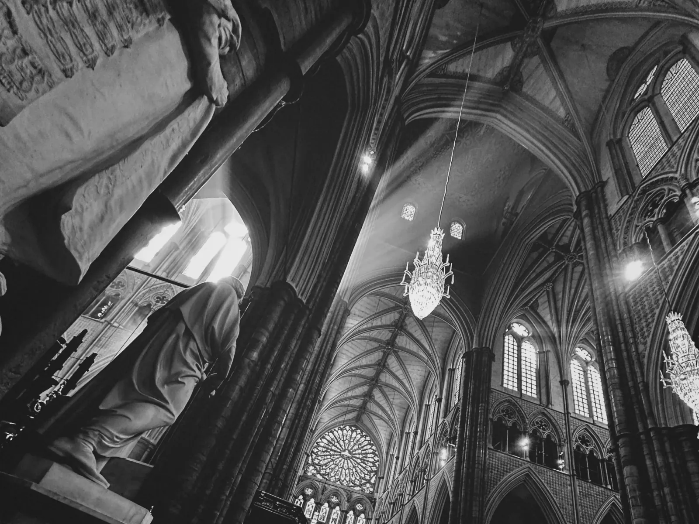
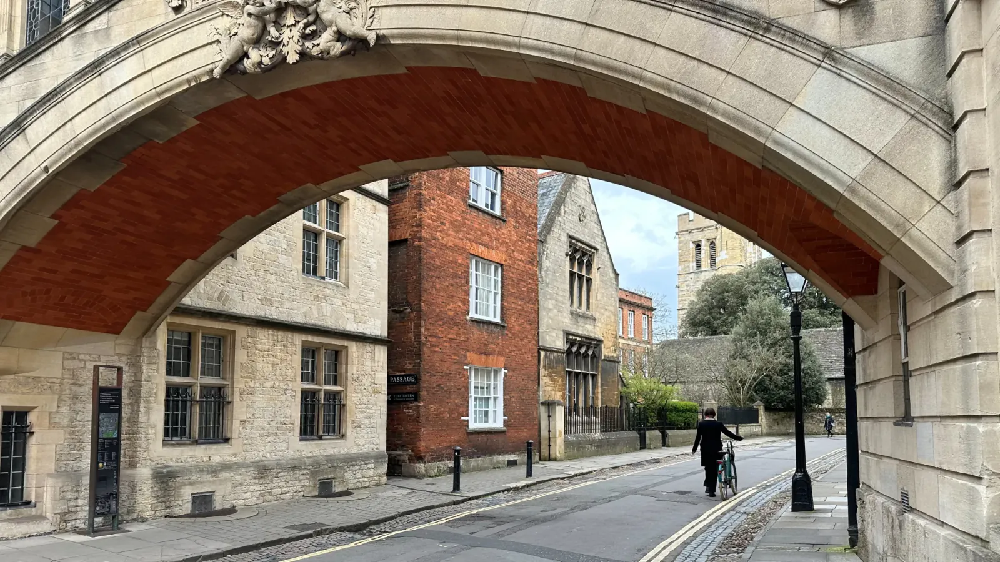
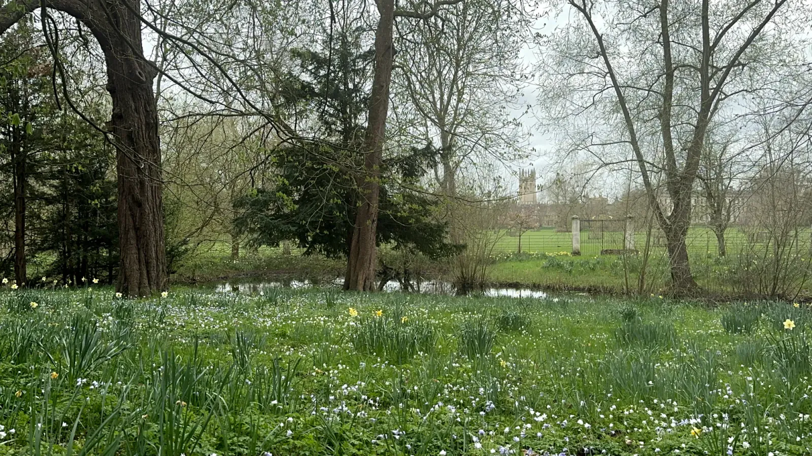
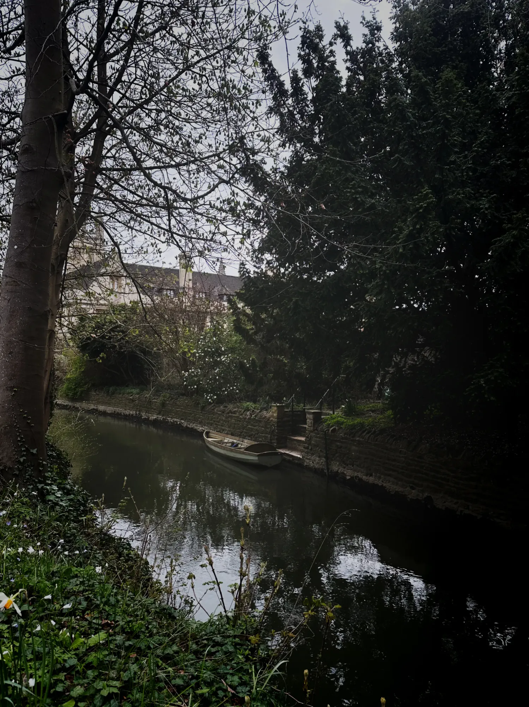
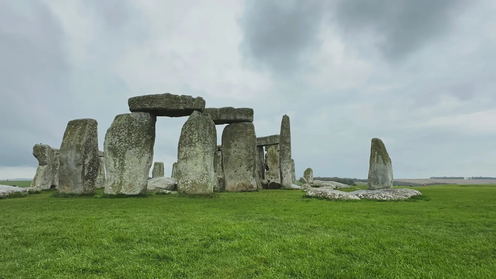
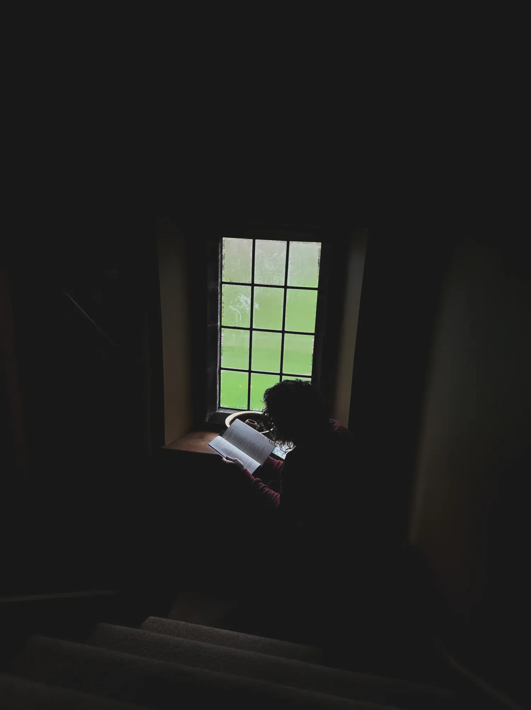
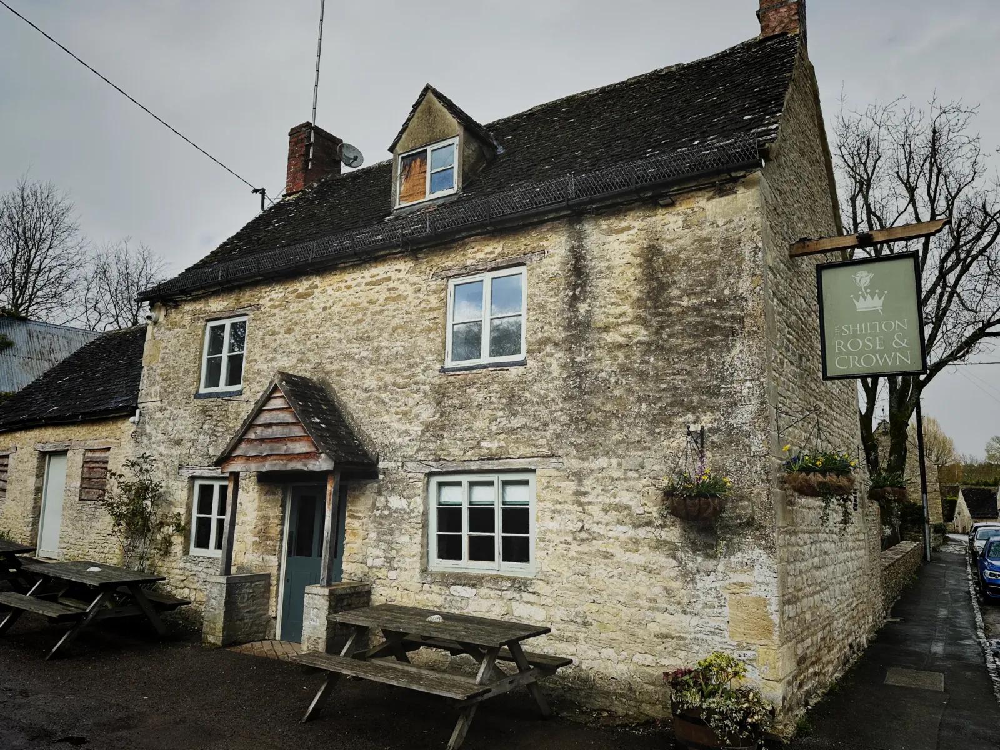
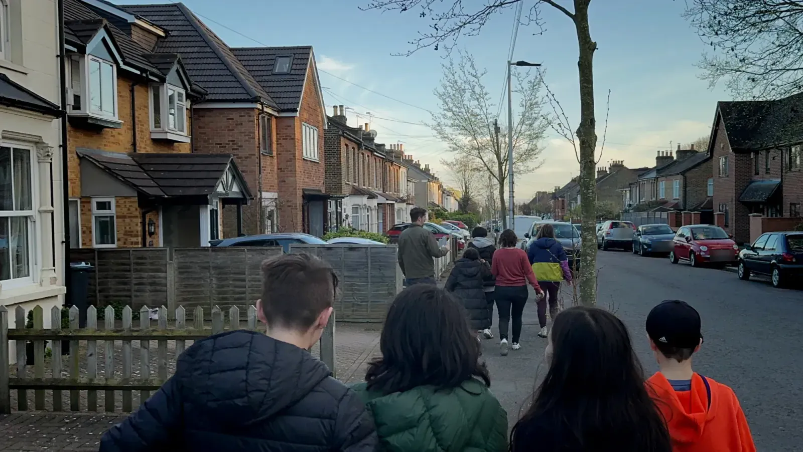
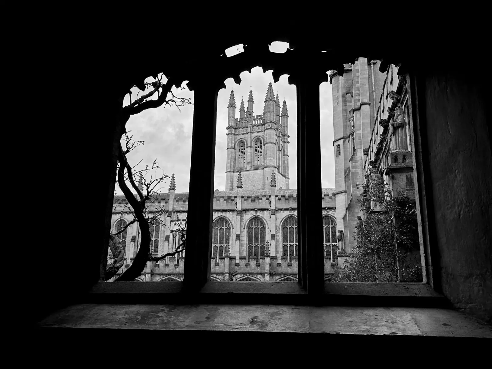
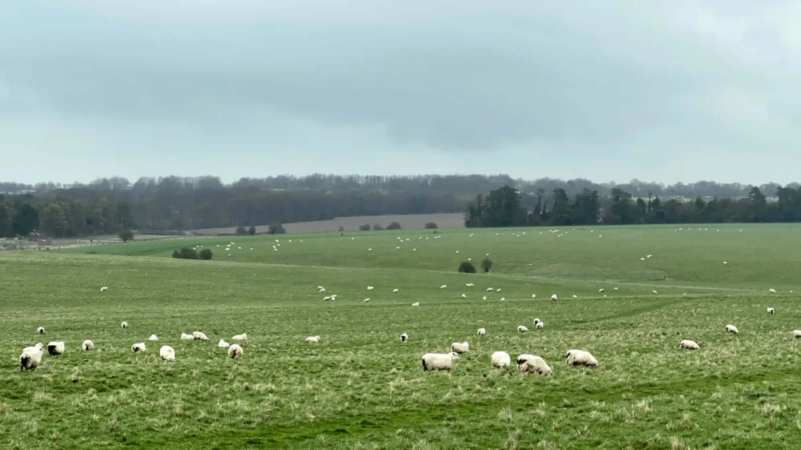
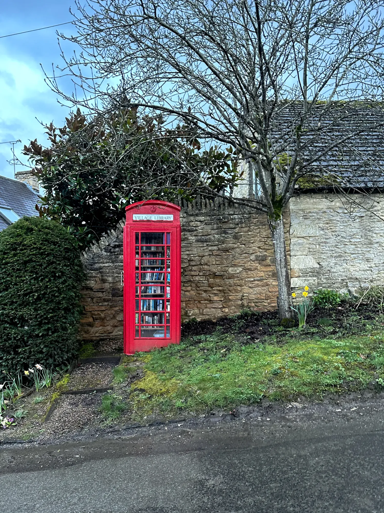
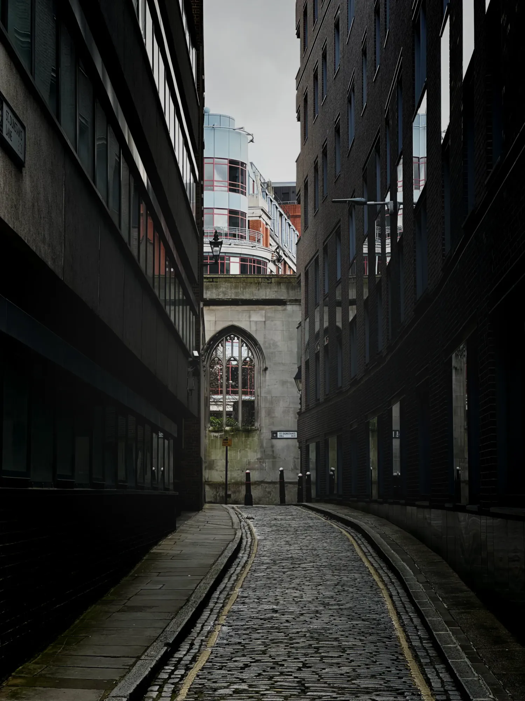
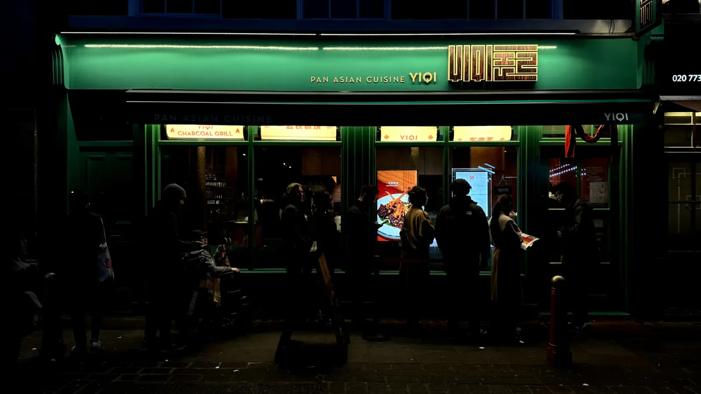
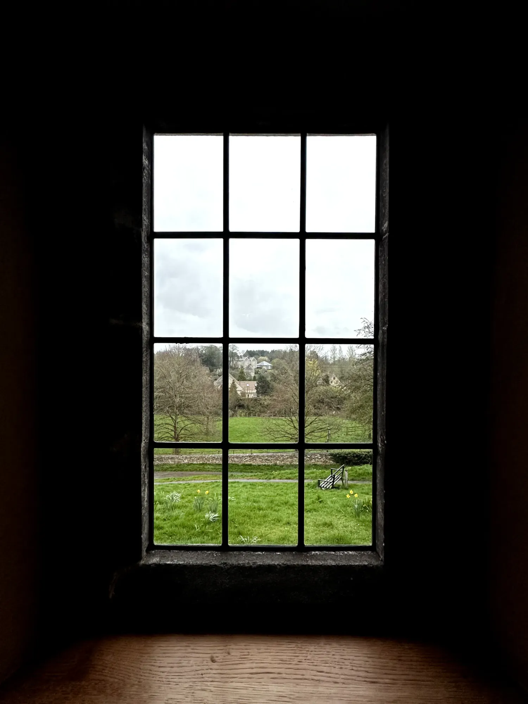