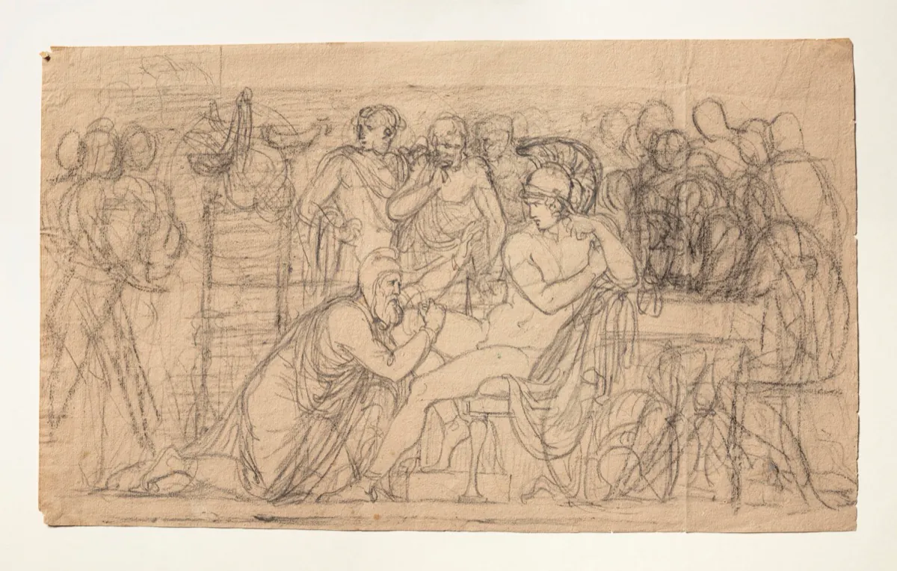

Homer's _Iliad_ does not promise it will be easy, but rather, it will be real.

I read it in my early 20s, and returning to it some decades later, this Homeric poem reminded me that clarity about duty, grief, and rage is perennial. In particuar, much of my formation in the last several years came from staying with difficulty. 

Rather than offering a tour of the _Iliad_, I prefer to speak of a few works I read alongside the poem:

- Simone Weil's _The Iliad, or the Poem of Force_
- Rachel Bespaloff's _On the Iliad_
- Alasdair MacIntyre's _A Short History of Ethics_[^1]

## Guarding the perishable joys

> The true hero, the true subject, the centre of _The Iliad_ is force. Force employed by man, force that enslaves man, force before which man's flesh shrinks away.  

Force, Weil says, is what turns a person into a thing, victors and vanquished alike. The poem refuses to pick sides because it sees what the Greeks and Trojans cannot: that they are the same beneath force, standing under the gods. Weil reads the _Iliad_ as a geometry of retibution where force rebounds -- the strong become weak, the victors become the vanquished as each steps into the current that has alrady swept others away.

Rachel Bespaloff sees something else. Whereas Weil sees only force, Bespaloff finds Hector who knows that Troy will someday fall: "For I know well in my entrails and my heart, a day will come when holy Troy will perish." He fights anyway not because he is certain of victory, but because this is what his life asks of him. He stays present to the perishable joys even as they slip away.

By contrast, Weil's nation force is made visible in Achilles after the loss of Patroclus. Achilles' rage is the rage of something trying to make force yield meaning, or to extract from it, after the fact. It cannot, so he becomes force itself: pitiless and mechnical, as Achilles slained Hector. And yet, then there is the scene where Priam comes to Achilles to reclaim the body of his son, Hector. Priam prostrates himself before the man who killed his son and dragged his corpse through the dust. Achilles, who has spent days in that frenzy of rage, looks at this old man and sees his own father. They weep together. And then they eat.

*Bertel Thorvaldsen, Priam Pleads with Achilles for Hector's Body, 1804-1815, Thorvaldsens Museum, C161r, photographer Jakob Faurvig*

Bespaloff writes:

> Here, I think, comes one of the most beautiful silences in the _Iliad_ -- one of those absolute silences in which the din of the Trojan War, the vociferations of men and gods, and the rumblings of the Cosmos, are engulfed.

Both sitting together, breaking bread. It is only possible because both have been stripped bare by grief. What is left is just two finite beings in the wreckage of war, choosing, briefly, to _see_ one another.[^2]

Weil and Bespaloff both wrote their essays as Europe descended into the Second World War. They were refugees, watching their world collapse, and turning to Homer was their way to make sense of human existence as Europe tore itself apart. Whereas Weil was to strip away the romanticized lens of "glory" associated with the _Iliad_., both essayists point us toward something real: a world in which suffering exists without consolation, and yet, within finitude, there remains room for perishable joys, even as Troy falls.  

## An open question that I'm sitting with

> Only he who has measured the dominion of force, and knows how not to respect it, is capable of love and justice.

This is Weil's closing note, and it's the one I keep coming back to the _Iliad_ doesn't teach me to despise force or to worship it, but more importantly, to measure it -- to see it clearly, to understand its power and its limit, so that I can choose how to live in relation to it.

[^1]: I intend to return to this note with MacIntyre in hand, particularly his account of Homeric ethics as role-bound and what that suggests about authority being carried without the promise of repair.

[^2]: In another instance, Helen walks through the _Iliad_ presently but absently, the cause of everything and nothing. Bespaloff reads her as a penitent who bears the weight of forces she never chose. What strikes me is how little agency Helen is portrayed in the poem, even though the war is ostensibly about her. She didn't choose Paris. She didn't choose the war. The gods chose for her, and now she watches from the walls as men die for a delusion that has nothing to do with who she actually is. Priam, again, seeing Helen as she is, does not blame Helen: "The real culprits, and the only ones, are the gods." It is an act of generosity in a poem soaked in violence.

