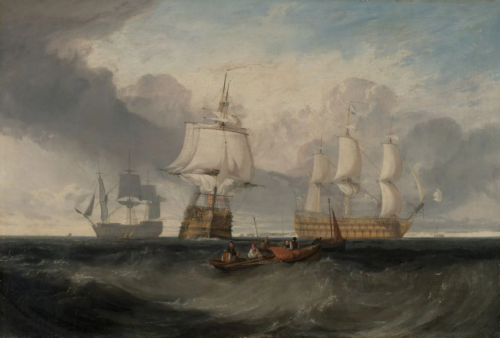

_This note gives away how the book ends._

_The Trumpet-Major_ comes first in my [[Wessex as a World]] reading plan, which follows the novels in story order. It is a courtship comedy, set in 1804–1805; still in a pastoral world. Anne Garland, a widow’s daughter living at Overcombe Mill, is courted by three men while the camps on the down wait for Napoleon: John Loveday, the miller’s son and a trumpet-major in the dragoons; his younger brother Robert, called Bob, a sailor; and Festus Derriman, a blustering yeoman. It is a gentle book, yet Hardy hides the ending in the second chapter, on top of a pole in the miller’s garden. I almost missed it:

> When the sun shone upon this figure it could be seen that the greater part of his countenance was gone, and the paint washed from his body so far as to reveal that he had been a soldier in red before he became a sailor in blue. The image had, in fact, been John, one of our coming characters, and was then turned into Robert, another of them.

The miller’s weathervane is a carved figure that has been repainted: a soldier in red, then a sailor in blue. Only on the last page do you see what it was: the whole plot, painted over.

Hardy adds one more detail, which keeps the vane from being a tidy prophecy:

> This revolving piece of statuary could not, however, be relied on as a vane, owing to the neighbouring hill, which formed variable currents in the wind.

The figure doesn’t point true. It turns with whatever the hill sends it, and it didn’t repaint itself. Anne is turned by her mother’s ambitions, by a camp arriving on the down, by a press-gang that comes for Bob, by news from Trafalgar. The people in this book are free to love. They are not free of the times they live in.

## What John carries

As in [[Under the Greenwood Tree]], Hardy lets objects do the telling. John Loveday rarely says what he feels; the things around him say it instead.

At Budmouth, Hardy’s Weymouth, Anne picks up a sweet-william that Festus has thrown from an inn window. Unsure what to do with it, she hands it to John and tells him it means nothing. He keeps it anyway:

> … he put the flower carefully inside his jacket, between his white waistcoat and his heart.

Later, Bob builds Anne an Æolian harp that seems to sing on windy nights, “Remember me! think of me!” She credits Bob, until he admits it was John’s idea. Then there’s her letter of apology, which John kisses when he thinks no one is looking.

None of these is a declaration; each is evidence of a feeling held back. The flower goes inside a jacket, the harp to his brother’s credit, the letter to his lips when no one is looking. All three hold John’s feeling, and he keeps it from reaching Anne. We see his love most clearly when it can no longer change anything.

## The good man and the loved man

Anne doesn’t choose John. Hardy names how hard it is:

> Any woman who has ever tried will know without explanation what an unpalatable task it is to dismiss, even when she does not love him, a man who has all the natural and moral qualities she would desire, and only fails in the social.

Near the end she tells him, “Gratitude is not love, though I wanted to make it so for the time.” John, for his part, spends the back half of the book stepping aside. He pretends to love an actress so his brother won’t feel guilty, and when Bob is slow to come back, he writes to call him home.

It would be easy to make Bob the villain (Hardy doesn’t). Bob forgets Anne for a woman he has known a fortnight, and later for a baker’s daughter in Portsmouth. He is also the boy who once ran into a burning cottage for a baby, the man who walks to Captain Hardy’s door to ask for the _Victory_, and the one who saws through the wall between his room and Anne’s because they are “now one family.” John’s love is held back. Bob’s is present, careless and warm, and it is the one she answers. Festus, the third suitor, has money and little else, and Hardy makes him comic because he thinks money should be enough.

I keep wanting to call John the right choice. But that is my measure, not Anne's: perhaps a reader's wish to see goodness rewarded.

## A comedy that knows the casualty list

The courtship is light, but Hardy wrote the book in 1879, some seventy-five years after the summer it describes. The narration keeps stepping out of the scene to tell us who will die. At the mill-pond, the miller hands cherries over the hedge to dragoons on horseback, who catch them in their forage-caps:

> It was a cheerful, careless, unpremeditated half-hour, which returned like the scent of a flower to the memories of some of those who enjoyed it, even at a distance of many years after, when they lay wounded and weak in foreign lands.

The dragoons don’t know. They are catching cherries in their caps. We as readers can’t share their innocence, because Hardy tells us, in the same sentence, where the memory will find them. It repeats — Sergeant Stanner sings a comic song about Boney at the miller’s party, and in the next paragraph he is trampled at Albuera. At the farewell, seven soldiers wish Anne well, and “five, including the trumpet-major, were dead men within the few following years.”

So in the end John isn’t only displaced by his brother. He is carried off by history:

> … in another moment he had plunged into the darkness, the ring of his smart step dying away upon the bridge as he joined his companions-in-arms, and went off to blow his trumpet till silenced for ever upon one of the bloody battle-fields of Spain.

Reading [[The Iliad]], Rachel Bespaloff sees Hector knowing that Troy will fall and staying present to the perishable joys anyway. Hardy’s characters don’t know. Only we do, which that is the harder place to read from. Hardy gives us the cherries and tells us, while they are being eaten, that they are perishable.

*J. M. W. Turner, The Victory Returning from Trafalgar, in Three Positions*