As we flew in, the land lay there and wide.

## Her, returning to a chapter; Me, a new sentence

Idaho bore and raised my wife. If Twin Falls was a chapter in her life, this is my trip, writing the first sentence into my life — arriving alongside someone whose story here began before mine. Her stories had already built a road in my mind. With fenceline and creeks.

Her parents, her sisters and their families, and we arranged to meet there. The childhood home is now a homestay; reason enough for them to return and to sleep again beneath the same roof.

We visited friends who had known her before I did, who spoke of her in its earlier tense. I watched her family and friends laugh at something I didn't have the context for. I felt no exclusion, and comforted by the tenderness of witnessing loved ones returning to a version of themselves that existed before I knew them.

## Shoshone Falls, Snake River, Perrine Bridge

At Shoshone Falls, what holds it: canyon walls, basalt columns stacked like cordwood by some ancient violence unwitnessed. At the Snake River, the canyon opens with ground running level, which in the next step falls sheer and sudden, the river moving below, cold and purposeful. The bridge crosses in a spare geometry of steel, a late addition to the older order. The children lean over the rim, measuring depth with their eyes. This is a part of the country showing its bones to the youth, beneath the sky a lidless blue. 

---

## Traces

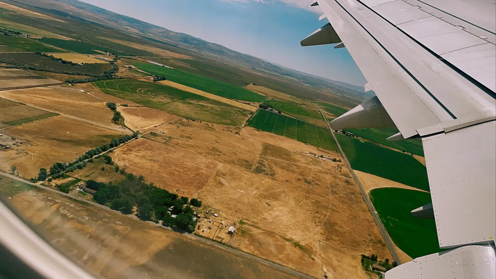
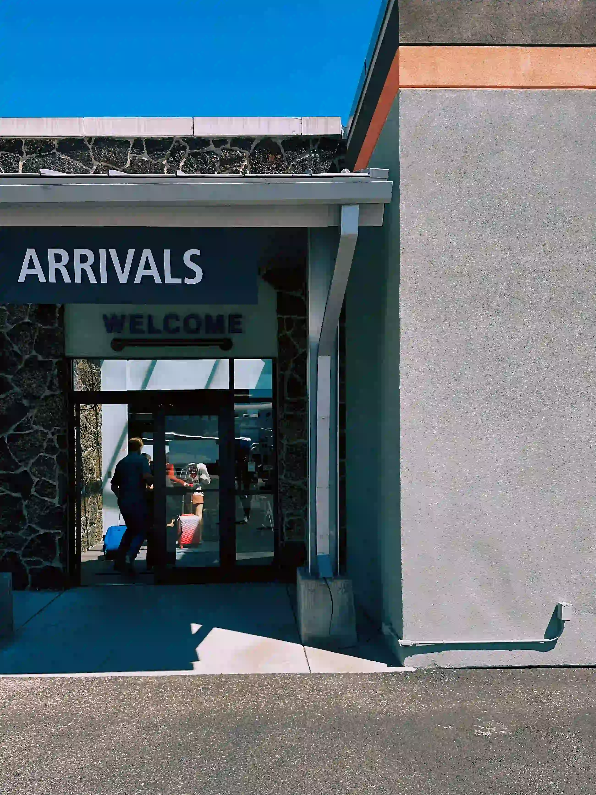
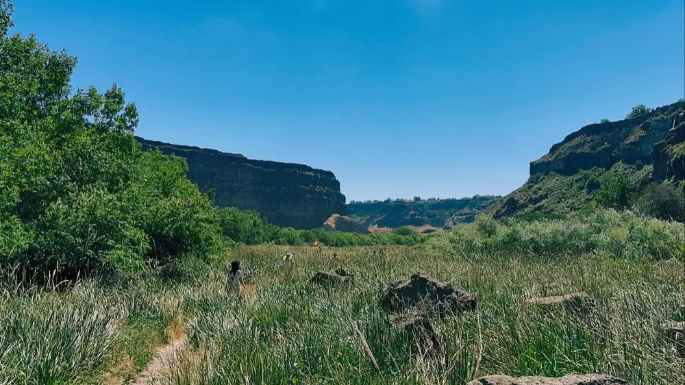
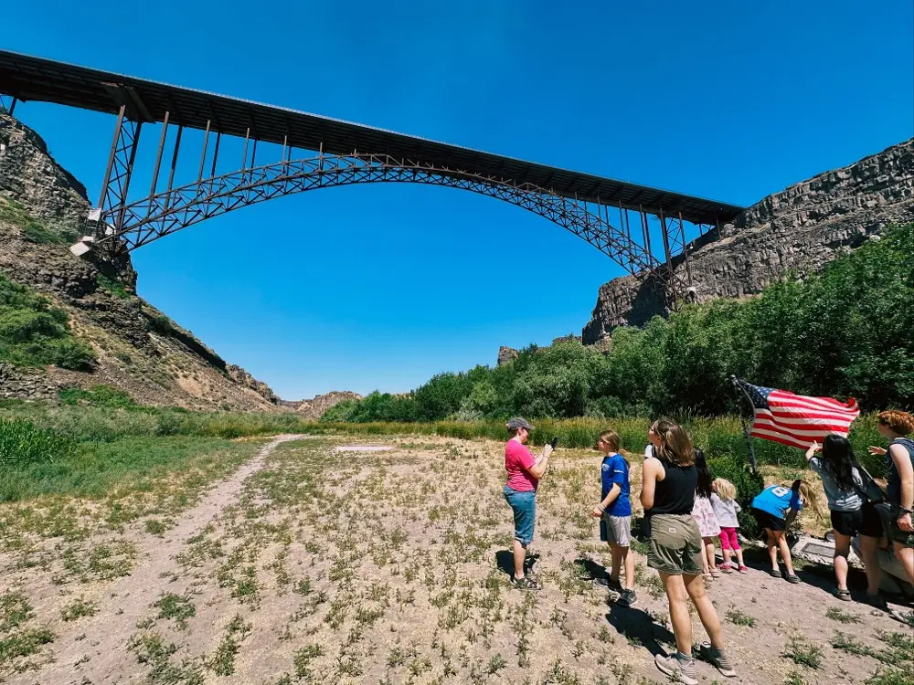
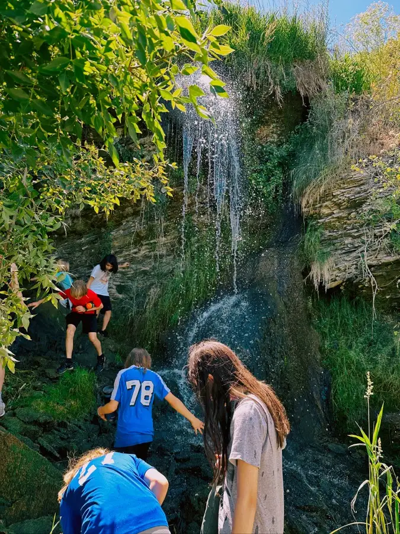
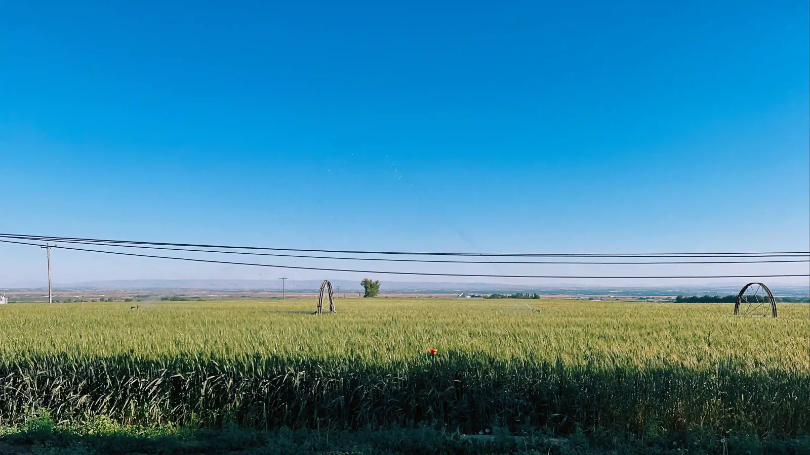
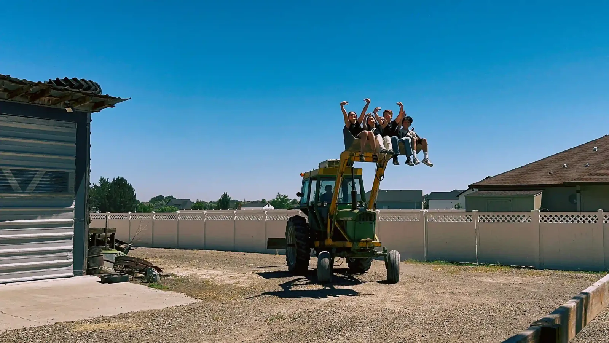
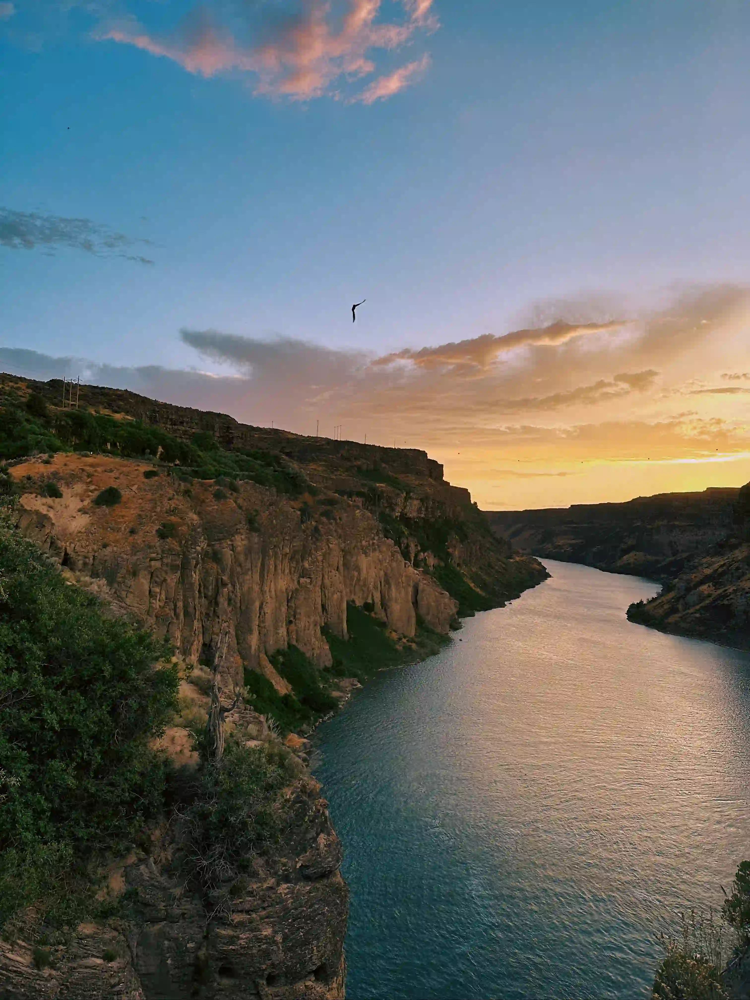
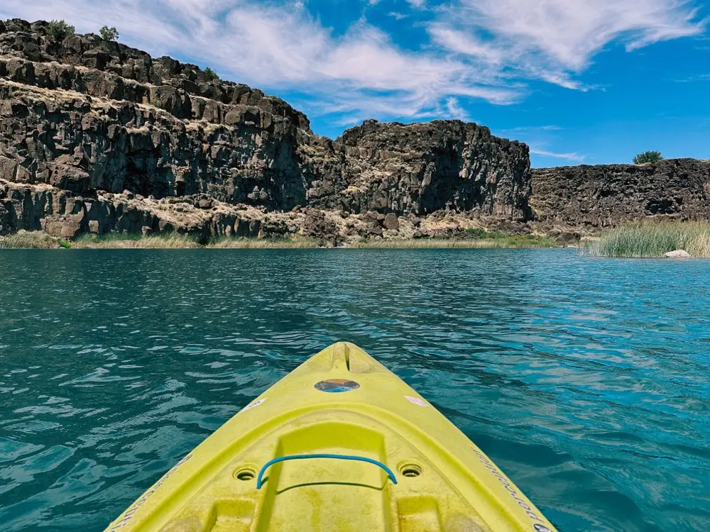
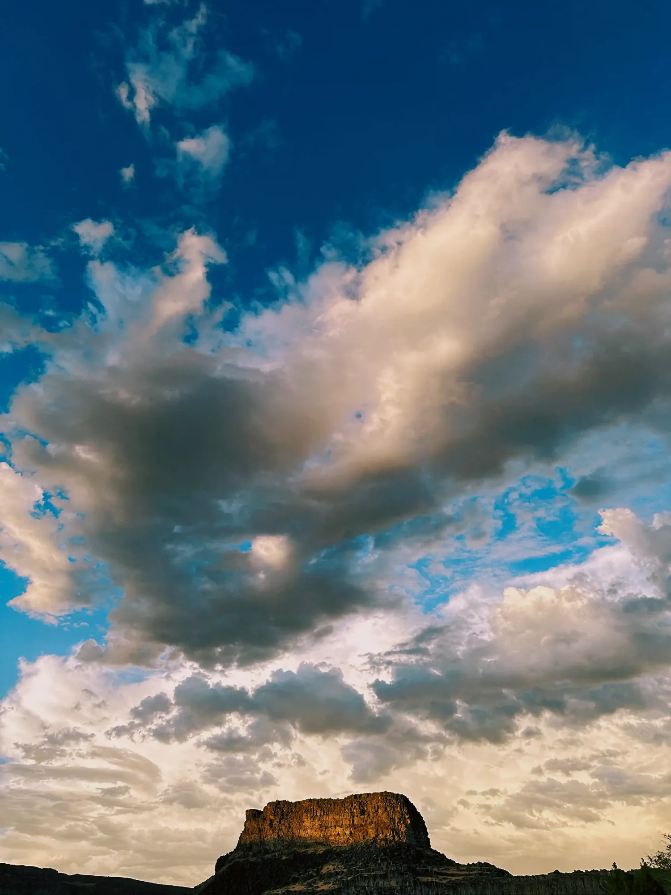
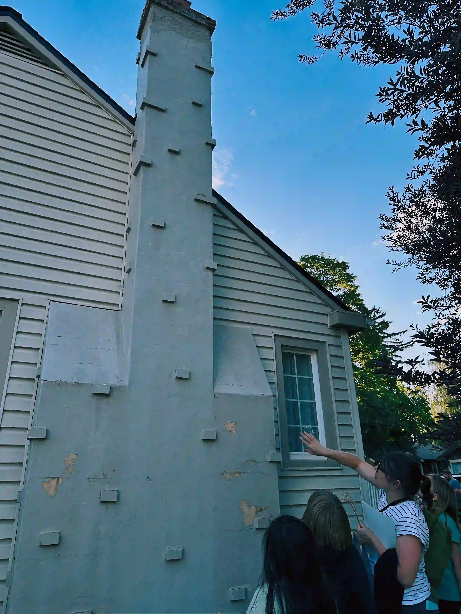
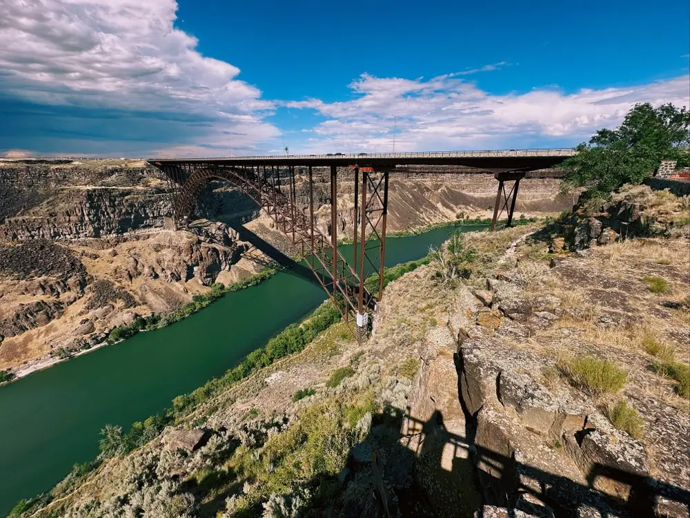
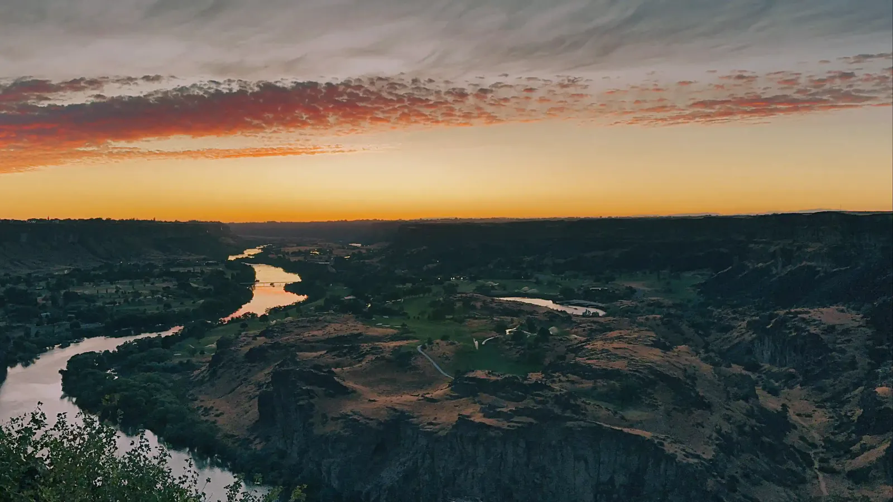