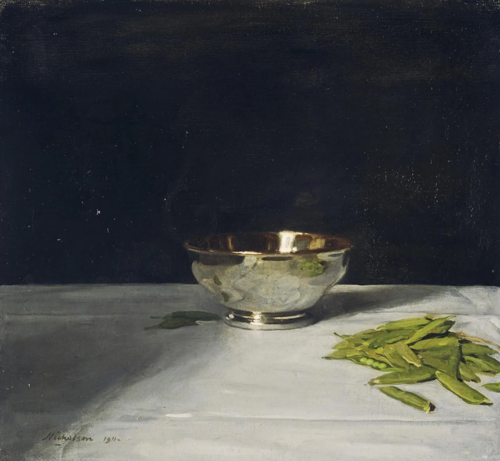

I came to _Under the Greenwood Tree_[^1] expecting pastoral charm, and found it in abundance. Yet what stayed with me was something more precise: Thomas Hardy’s understanding that rooms and houses and small possessions are evidence. Each object in a place is the accumulated residue of a life.

> The ceiling was carried by a beam traversing its midst, from the side of which projected a large nail, used solely and constantly as a peg for Geoffrey’s hat; the nail was arched by a rainbow-shaped stain, imprinted by the brim of the said hat when it was hung there dripping wet.

There is a nail in the ceiling beam of Geoffrey Day’s house. It serves one purpose: to hold his hat when he comes in from the woods. Hardy notes, almost in passing, that the nail is arched by a rainbow-shaped stain, imprinted by the brim of the hat.

That’s it. No gloss, and no explanation of what this means about Mr. Day, or how long he has lived there, or what kind of man hangs his hat in the same spot through every kind of weather for years. Hardy shows you the stain, and perhaps you do not know all of it — but you know it now. This is his method. The object has already done the living, and it’s our job to see it.

> The window was set with thickly-leaded diamond glazing, formed, especially in the lower panes, of knotty glass of various shades of green. Nothing was better known to Fancy than the extravagant manner in which these circular knots or eyes distorted everything seen through them from the outside—lifting hats from heads, shoulders from bodies; scattering the spokes of cart-wheels, and bending the straight fir-trunks into semicircles.

The knotty glass in Geoffrey’s windows is a version of the same thing. The glass is old, full of circular imperfections—“eyes,” Hardy describes them—that distort everything seen from the outside. Hardy doesn’t describe this to establish the cottage’s age or character, not quite, but because Geoffrey’s daughter, Fancy, _knows_ this glass; more so, she knows exactly how it warps the world. That intimacy is itself a kind of character. You don’t know a place that way unless you have looked outside (and inside) from it, season after season.

## Interiority rendered through an object

A question of a place that Hardy enters: _what in this space has survived?_

The answer is not abstract. It is a stain, a worn threshold, glass that bends the world, a handkerchief carried too long. The meaning of an object accumulates quietly until you notice that interiority is rendered through it.

I found this useful as a reader, and then as someone learning how to write about a place. Particularly, I reach for light and atmosphere. On the contrary, Hardy pushes me toward something harder and more specific: what are the objects that have done the living here? Not quite the furniture that sets the scene, but the evidence. The mug left on a particular shelf for no reason you or I could explain anymore. The chair arm smooth on one side, but not on the other. What is kept even though it’s broken, because throwing it away would require acknowledging something.

That is where the life is. Hardy knows this, and he’s trusting readers to know it too. He puts it there.

## Through their particulars

In the book, the Mellstock choir (and their instruments) is displaced by Fancy and her organ. Hardy doesn’t argue the loss. Instead, he shows the old quire watching the curls of her hair as she plays — her hat, her feather, and her confidence, modern for their time. The loss is registered without polemic. Instead, what is being watched, and by whom, and what they are no longer doing with their hands. A new dispensation under which they grieve unsentimentally.

Hardy reads lives through their particulars. There is no imposition of meaning; rather, we wait the objects to tell. I didn’t go looking for what the stain signifies. I read the stain, stayed with it, and eventually it tells me what it knows.

*Sir William Nicholson, The Lustre Bowl with Green Peas*

[^1]: I read _Under the Greenwood Tree_ as part of the [[Wessex as a World]] reading plan.